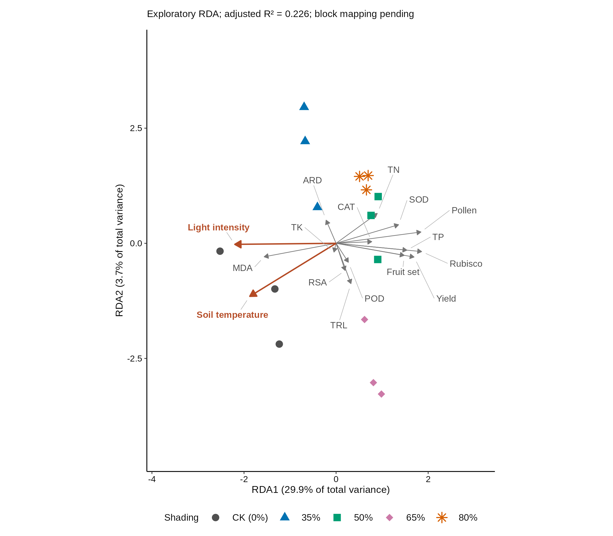

# Shading experiment: existing exploratory RDA results

These are existing RDA outputs. No analysis, statistical test, figure rendering or conversion was rerun for this pull request. The existing PNG preview, PDF, 600-dpi TIFF and R script were copied byte for byte.

| File | Contents |
| --- | --- |
| [RDA_shading.png](RDA_shading.png) | PNG preview, displayed above |
| [RDA_shading.pdf](RDA_shading.pdf) | Editable vector figure |
| [RDA_shading_600dpi.tiff](RDA_shading_600dpi.tiff) | 600-dpi RGB TIFF, lossless LZW compression |
| [statistics.xlsx](statistics.xlsx) | Existing statistical results, with the raw-value IQR flag sheet excluded |
| [analysis.R](analysis.R) | Original analysis and figure-generation script; provided for documentation, not executed here |
| [SHA256SUMS.txt](SHA256SUMS.txt) | Checksums of the five delivered artifacts |

## Interpretation and design limitation

The experiment used a randomized complete block design: three planting ridges, each containing all five shading treatments, with 15 independent plots in total. Replicate suffixes do not identify blocks. Actual plot-to-ridge membership is unavailable and was never inferred.

The current ordination is exploratory and unadjusted for block. Formal RCBD permutation P values are unavailable, not nonsignificant. No confirmatory significance claim is made.

| Existing summary | Value |
| --- | ---: |
| RDA1, percentage of total standardized response variance | 29.8923% |
| RDA2, percentage of total standardized response variance | 3.7242% |
| Model R-squared | 0.336165 |
| Adjusted R-squared | 0.225525 |
| Retained environmental predictors | Light intensity and soil temperature |

TN, TP and TK represent branch tissue total nitrogen, phosphorus and potassium. The figure uses all 15 plots and 14 plant responses. Detailed diagnostics and sensitivity results remain in the workbook.

## Privacy and preservation

No experimental source workbook, raw observation matrix, standardized observation matrix, fitted-model object, archive containing raw data, credential or private working file is included.

The original local statistical workbook is preserved. Only the upload copy excludes `18_iqr_flags_retained`, which held individual raw measurement values, and updates its sheet index. Every cell in every retained statistical results sheet was verified unchanged. Figure files and the R script are unchanged.

The R script refers to an input workbook and optional block mapping that are intentionally not included. Downloading and viewing these results does not require running R. If the script is used separately, the documented R packages and privately supplied source data are prerequisites.
