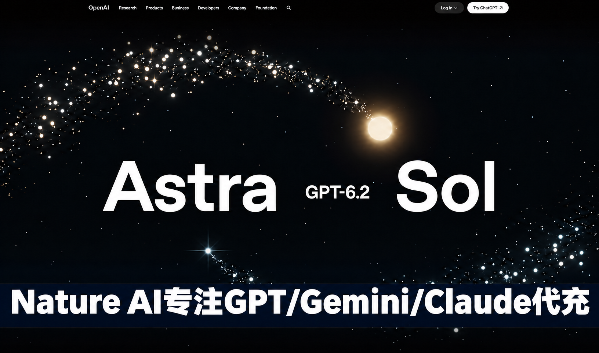
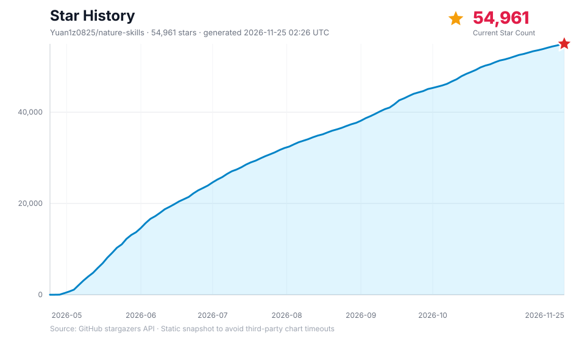

<div align="center">
  <p>
    
  </p>
  <p>
    <a href="LICENSE"></a>
    <a href="#5-インストール"></a>
    <a href="#6-スキル一覧"></a>
    <a href="README.md"></a>
  </p>
  <p>
    <a href="https://yuan1z0825.github.io/nature-skills/">Web サイト</a>
    · <a href="#5-インストール">インストール</a>
    · <a href="#4-クイックスタート">クイックスタート</a>
    · <a href="#6-スキル一覧">スキル一覧</a>
    · <a href="docs/open-source-agent-frameworks_EN.md">その他のインストール</a>
    · <a href="#7-コントリビューションと開発">コントリビューション</a>
    · <a href="README_EN.md">English</a>
    · <a href="README.md">中文</a>
  </p>
</div>

---

`nature-skills` は、世界中の AI 研究者のための再利用可能な研究スキルを集めたものです。実際の問題解決、検証可能なワークフロー、そしてそのまま使える研究成果物を重視しています。

## 目次

- [1. プロジェクト創設者と運営](#1-プロジェクト創設者と運営)
  - [1.1 創設者の紹介](#11-創設者の紹介)
  - [1.2 知識星球](#12-知識星球)
  - [1.3 リポジトリストア](#13-nature-ai-の-gpt-と-claude-のチャージと既製アカウント)
  - [1.4 ビジネス提携](#14-ビジネス提携)
- [2. Nature Skills コア開発者](#2-nature-skills-コア開発者)
- [3. プロジェクトの理念とコミュニティ](#3-プロジェクトの理念とコミュニティ)
- [4. クイックスタート](#4-クイックスタート)
- [5. インストール](#5-インストール)
  - [5.1 `npx skills` によるインストール](#51-npx-skills-によるインストール)
  - [5.2 Claude Code へのインストール](#52-claude-code-へのインストール)
  - [5.3 Codex へのインストール](#53-codex-へのインストール)
  - [5.4 Chatbox のインストールと使い方](#54-chatbox-のインストールと使い方)
  - [5.5 その他のエージェントでの利用](#55-その他のエージェントでの利用)
- [6. スキル一覧](#6-スキル一覧)
- [7. コントリビューションと開発](#7-コントリビューションと開発)
- [8. Star History](#8-star-history)

## 1. プロジェクト創設者と運営

### 1.1 創設者の紹介

こんにちは、`nature-skills` の創設者の Yizhe Yuan です。このプロジェクトに関心を持っていただきありがとうございます。Douyin で多くの動画チュートリアルを公開しています。トピック名で検索すると見つかりますので、実際の研究活動のお役に立てば幸いです。現在、就職先を探しています。下の QR コードをスキャンして、お気軽にご連絡ください。

### 1.2 知識星球

知識星球（Knowledge Planet）の名前：**Nature Skills とその背後にある哲学**。


### 1.3 Nature AI の GPT と Claude のチャージと既製アカウント

私たちはサービスチャネルを慎重に選定し、正規のチャージチャネルとサポートを提供しています。
**Nature AI Recharge Card Store** をご覧ください：

<table>
  <tr>
    <td align="center" width="68%">
      <a href="https://apiciyuan.top/">
        
      </a>
      <br>
      <strong>Nature AI Recharge Card Store</strong>
      <br>
      <a href="https://apiciyuan.top/">https://apiciyuan.top/</a>
    </td>
    <td align="center" width="32%">
      
      <br>
      <strong>WeChat サポート</strong>
      <br>
      <sub>スキャンして追加</sub>
    </td>
  </tr>
</table>

### 1.4 ビジネス提携

ビジネス提携については、[natureskills2026@outlook.com](mailto:natureskills2026@outlook.com) までご連絡ください。

## 2. Nature Skills コア開発者

| 開発者 | プロジェクトでの役割 | 主な担当と貢献 | プロフィールと連絡先 |
|---|---|---|---|
| **Yizhe Yuan** | 創設者 / メンテナー | プロジェクトの立ち上げ、スキル体系の設計、コミュニティ運営 | — |
| **Xin-Rui Ma** | コア開発者 | コア開発とアーキテクチャの保守 | [Gmail](mailto:travisma2233@gmail.com) |
| **Bin Hu** | 主要コントリビューター | エージェント型エージェントと AI for Science | [GitHub](https://github.com/Flyme886) · [Email](mailto:mhoang12205@gmail.com) |

## 3. プロジェクトの理念とコミュニティ

### 3.1 個人的な見解

- 最近、Nature Skills の設計が Google DeepMind の注目を集め、参照されていることに気づきました。
  彼らはその引用システム、スクリプトのアイデア、スキル設計の哲学を参考にして Science Skills を
  立ち上げました。正直に言うと、これはうれしいことです。国際的な主要 AI 機関が私たちの仕事から
  着想を得始めたということは、中国の開発者による独自のアイデアが世界に見られているということです。
  これは模倣されたことによる喪失感ではなく、中国の力がオープンソースに根付き、
  自然に外へと成長しているしるしです。
- 私たちのスキル設計の主眼は、すべてのユーザーに哲学全体を完全に習得してもらうことでは
  ありません。大切なのは、その哲学自体を機械が理解し再利用できることです。新しいスキルを作りたい、
  あるいはこの仕組みを自分の分野に適用したい場合は、Nature Skills の GitHub リポジトリを
  Codex に渡して設計パターンを学ばせ、スキルの作成や修正を手伝ってもらうことができます。
  こうしてアイデアは口頭の説明にとどまらず、実際に運用できるものになります。
- Nature Skills の本当の価値は、個々のモジュールにとどまらないのかもしれません。
  このプロジェクトは、静かに新しい扉を開いたのかもしれません。多くの人が、Codex やほかの
  エージェントがローカルのコンピューターを操作して研究できることに初めて気づいたのです。
  私は幸運にも、多くの人がこうした研究ワークフローの変化を経験するのを目にし、寄り添ってきました。
  彼らが「研究はこんなふうにできるのか」と言うとき、その理解の飛躍と思考の解放は、私にとって
  スキルそのものよりも大切です。これは単なるツールの成功ではなく、新しい考え方が人々の間に
  広がり始めたということです。
- 実際には、役に立つツールのほとんどは標準化されたプロセスに落とし込むことができ、
  標準化されたプロセスは再利用可能なスキルとしてパッケージ化できます。

### 3.2 チュートリアルとコミュニティ

<table>
  <tr>
    <td align="center">
      <b>Douyin をフォローして動画チュートリアルを見る</b><br>
      
    </td>
    <td align="center">
      <b>エージェント研究コミュニティ</b><br>
      
    </td>
    <td align="center">
      <b>Yuan の個人 WeChat</b><br>
      
    </td>
  </tr>
</table>

## 4. クイックスタート

インストール後は、論文、段落、査読者からの手紙、タスクの説明をそのままエージェントに
渡すことができます。以下のプロンプトはそのままコピーして使えます：

| 目的 | プロンプト |
| --- | --- |
| 論文を読む / 対訳リーダー | `Turn this PDF into a figure-aware Chinese-English Markdown reader.` |
| 論文発表資料を作る | `Create a Chinese journal-club PPT from this paper, keeping key figures and source labels.` |
| 原稿の段落を推敲・翻訳する | `Rewrite this Chinese paragraph into Nature-style academic English without changing the meaning.` |
| 要旨、序論、考察の草稿を書く | `Using these results and figures, draft a Nature-style abstract and introduction.` |
| 投稿前の査読をシミュレーションする | `Evaluate this manuscript from a Nature reviewer perspective, produce three mutually blind reviewer reports, and synthesize them only after all are final.` |
| 査読コメントに回答する | `Use this revision email to draft a separate point-by-point response for each mutually blind reviewer and a cover letter, and mark redline locations in the revised manuscript.` |
| 文献検索、厳密な被引用、引用者のプロフィール | `Create a table with this paper's citation count, strict external citation count, DOI, and whether major scholars or Fellows cited it.` |
| 科学的な図や模式図を作る | `Use this method and result description to draft a publication-ready scientific figure or manuscript schematic.` |

どのスキルを使えばよいかわからない場合は、タスクを自然な言葉で説明してください。スキル名が
わかっている場合は、プロンプトで「`nature-reader` を使って」や「`nature-response` を
使って」と明示してください。

## 5. インストール

`nature-skills` は、`SKILL.md` を中心に構成された再利用可能なスキルパッケージの
コレクションです。`skills/` 以下の各トップレベルのスキルディレクトリ（`nature-*` など）が
インストール可能な単位であり、`nature-shared` はほかのスキルから読み込まれる、
インストール可能なサポートパッケージです。

### 5.1 `npx skills` によるインストール

まず [Node.js 18 以降](https://nodejs.org/) をインストールしてください。CLI をグローバルに
インストールする必要はありません。このリポジトリで利用できるスキル名を一覧表示します：

```bash
npx skills add Yuan1z0825/nature-skills --list
```

まずは現在のタスクに必要なスキルから始め、その共有依存関係も含めてください。
プロジェクトローカルにインストールする場合は `--global` を省略し、プロジェクトをまたいで
スキルを使いたい場合は追加してください。例：

```bash
npx skills add Yuan1z0825/nature-skills --agent codex --skill nature-figure --yes --copy
```

`nature-reader`、`nature-paper2ppt`、`nature-polishing`、`nature-writing` を
単独でインストールする場合は、共有サポートパッケージも選択してください：

```bash
npx skills add Yuan1z0825/nature-skills --global --agent codex \
  --skill nature-reader --skill nature-shared --yes --copy
```

コレクション全体が必要な場合は、すべてのスキルを Codex 向けにグローバルにインストールします。
この選択には `nature-shared` も含まれます：

```bash
npx skills add Yuan1z0825/nature-skills --global --agent codex --skill '*' --yes --copy
```

CLI がサポートするすべてのエージェントにすべてのスキルをインストールするには：

```bash
npx skills add Yuan1z0825/nature-skills --all
```

Codex のグローバルインストールを確認し、後で更新するには：

```bash
npx skills list --global --agent codex --json
npx skills update --global --yes
```

特定のスキルだけを更新する、または現在のプロジェクトのスキルだけを更新するには：

```bash
npx skills update nature-reader --global --yes
npx skills update --project --yes
```

`--skill` には `--list` で表示される frontmatter の名前を渡してください。たとえば
`nature-proposal-writer` ディレクトリは、現在 `researchwrite` として表示されます。
`npx skills` が管理するのはスキルファイルだけです。オプションの Python、R、ブラウザ、MCP の
ランタイム依存関係は、以下で説明する別途のセットアップが必要です。

### 5.2 Claude Code へのインストール

`scripts/update-codex-skills.sh` はスキルを Codex の `~/.codex/skills/` に同期するだけなので、
Claude Code では直接使えません。Claude Code では、安定したローカルクローンを保持し、
実際の `skills/*/SKILL.md` を指す subagent またはスラッシュコマンドのラッパーを作成してください。
これによりスキルのディレクトリ構造が保たれ、ワークフローは引き続き `references/`、`static/`、
`manifest.yaml`、スクリプト、アセット、`skills/nature-shared/` を使えます。

Claude Code をまだインストールしていない場合：

```bash
npm install -g @anthropic-ai/claude-code
claude
```

リポジトリを安定したパスにクローンします：

```bash
mkdir -p ~/ai-skills
cd ~/ai-skills
git clone https://github.com/Yuan1z0825/nature-skills.git
```

推奨される方法：よく使うスキルについて Claude Code の subagent ラッパーを作成します。
`nature-reader` の例：

```bash
mkdir -p ~/.claude/agents
cat > ~/.claude/agents/nature-reader.md <<'EOF'
---
name: nature-reader
description: Use for Chinese-English paper reading, figure-aware translation, and source-grounded paper notes.
---

When invoked, first read `~/ai-skills/nature-skills/skills/nature-reader/SKILL.md` and follow it as the governing workflow.
Read supporting files from `~/ai-skills/nature-skills/skills/nature-reader/` and `~/ai-skills/nature-skills/skills/nature-shared/` only when needed.
Do not replace this skill with a generic paper-reading response.
EOF
```

次に、新しい Claude Code セッションを開始し、subagent を明示的に指定して依頼します：

```text
Use the nature-reader subagent to turn this paper into a Chinese-English Markdown reader.
```

スラッシュコマンドを使いたい場合は、代わりにコマンドラッパーを作成します：

```bash
mkdir -p ~/.claude/commands
cat > ~/.claude/commands/nature-reader.md <<'EOF'
Read `~/ai-skills/nature-skills/skills/nature-reader/SKILL.md` first and follow it strictly.
Read directly needed supporting files from `~/ai-skills/nature-skills/skills/nature-reader/` and `~/ai-skills/nature-skills/skills/nature-shared/`.

$ARGUMENTS
EOF
```

Claude Code の中で次のように使います：

```text
/nature-reader Turn this paper into a full Chinese-English side-by-side Markdown reader.
```

ほかのスキルをインストールするには、`nature-reader` を対象のディレクトリ名
（`nature-polishing`、`nature-writing`、`nature-reviewer`、
`nature-response`、`nature-figure` など）に置き換えてください。後で更新するには：

```bash
cd ~/ai-skills/nature-skills
git pull
```

ラッパーがこの安定したクローンのパスを指している限り、ファイルを繰り返しコピーする
必要はありません。

**自動更新（オプション）**

セッションを開始するたびに Claude Code が上流の更新を自動で取り込むようにしたい場合は、
`scripts/autoupdate-skills.sh` を `SessionStart` フックと組み合わせて使います。

この方法では、上記のラッパーを使う代わりに、スキルを `~/.claude/skills/` に直接 **コピー** します
（Claude Code はこのディレクトリを自動で検出し、各スキルをディレクトリ名で読み込みます）。
どちらか好きな方を選んでください。

**専用の** 安定したクローンを用意します（スキルの同期専用で、その中で開発用のコミットは
しないでください）：

```bash
mkdir -p ~/ai-skills
git clone https://github.com/Yuan1z0825/nature-skills.git ~/ai-skills/nature-skills
```

一度インストールを実行し、スキルを Claude Code のスキルディレクトリにコピーします：

```bash
~/ai-skills/nature-skills/scripts/autoupdate-skills.sh --force
```

次に、`~/.claude/settings.json` に `SessionStart` フックを追加します（既存の `hooks` ブロックを
置き換えるのではなく、このエントリーをマージしてください）：

```json
{
  "hooks": {
    "SessionStart": [
      {
        "hooks": [
          {
            "type": "command",
            "command": "$HOME/ai-skills/nature-skills/scripts/autoupdate-skills.sh",
            "async": true,
            "timeout": 120
          }
        ]
      }
    ]
  }
}
```

`async: true` によってバックグラウンドで実行されるため、起動をブロックすることはありません。
このスクリプトは常時実行しても安全です。直近1時間以内に確認済みであればネットワークアクセスを
スキップし、オフラインのときや pull に失敗したときは何も表示せずにスキップし（`exit 0`。
セッションを止めることはありません）、上流の HEAD が変わったときやインストール済みのコピーに
ずれが生じたときに再同期し、コミットされていない変更があるクローンの fast-forward は拒否します。
新しいスキルは **次の** セッションから有効になります（現在のセッションはすでにスキルを
読み込んでいます）。宛先ごとに個別のログが
`~/.local/state/nature-skills/<destination-id>/autoupdate.log` にあります。

宛先と確認間隔はどちらも設定できます：

```bash
# Defaults to ~/.claude/skills; use --dest for another location, e.g. Codex:
~/ai-skills/nature-skills/scripts/autoupdate-skills.sh --dest ~/.codex/skills
# Check the network at most once per hour; still verify the local install each run:
~/ai-skills/nature-skills/scripts/autoupdate-skills.sh --throttle 3600
```

### 5.3 Codex へのインストール

スキルのコレクション全体をインストールまたは更新する場合は、リポジトリのスクリプトを使います。
このスクリプトは `skills/` 以下のすべてのトップレベルのスキルディレクトリを同期し、コピーした
内容を `diff` で検証します。関係のない Codex のスキルは上書きしません。一部のスキルだけを
選ぶ場合は、上記の `npx skills` によるインストールを使ってください。

```bash
git clone https://github.com/Yuan1z0825/nature-skills.git
cd nature-skills
scripts/update-codex-skills.sh --pull
```

すでにクローンがある場合：

```bash
cd nature-skills
scripts/update-codex-skills.sh --pull
```

現在の Codex のインストールがこのチェックアウトと一致していることを確認します：

```bash
scripts/update-codex-skills.sh --check
```

このスクリプトを長期的な更新に使っていて、以前このインストーラーが管理していたものの
上流にはもう存在しないディレクトリを削除したい場合：

```bash
scripts/update-codex-skills.sh --pull --prune
```

`--prune` は、このインストーラーが記録したディレクトリだけを削除します。関係のないスキルを
推測して削除することはありません。

リポジトリのインストールを Codex に依頼することもできます：

```text
Install Codex skills from this repository:
https://github.com/Yuan1z0825/nature-skills.git

Clone the repository, run scripts/update-codex-skills.sh --pull, and then run
scripts/update-codex-skills.sh --check to verify the installation. Keep complete
skill directories under skills/; do not copy only SKILL.md.
```

1つのスキルだけをインストールするには、スキル名を指定します：

```text
Install only nature-reader from this repository:
https://github.com/Yuan1z0825/nature-skills.git

If the skill needs shared files, install skills/nature-shared as well.
```

重要なルール：ディレクトリ構造全体を保ってください。多くのスキルは `references/`、`static/`、
`manifest.yaml`、スクリプト、アセット、または共有ファイルに依存しています。

インストーラーは Python の依存関係を自動でインストールしません。対応するスクリプトや
MCP サービスが必要な場合にのみインストールしてください：

```bash
python -m pip install -r skills/nature-paper-to-patent/requirements.txt
python -m pip install -r skills/nature-paper-to-patent/scripts/disclosure/requirements-cnipa.txt  # optional CNIPA published-patent search
python -m pip install -r skills/nature-academic-search/mcp-server/requirements.txt
```

`nature-paper-to-patent` の CNIPA 公開特許検索を有効にする場合は、`python -m playwright install chromium` も実行してください。

`nature-academic-search` には `PUBMED_EMAIL` も必要です。オプションの Scopus、
ScienceDirect、その他のプロバイダーの認証情報はローカルで設定し、
リポジトリにコミットしないでください。

インストール後、新しい Codex セッションを開始し、タスクを自然な言葉で説明してください。
例：

```text
Turn this paper into a full Chinese-English side-by-side Markdown reader.
```

```text
Create a Chinese PPT deck from this paper.
```

OpenClaw、OpenCode、Hermes、その他のオープンソースのエージェントフレームワークについては、[OpenClaw / OpenCode / Hermes 連携ガイド](docs/open-source-agent-frameworks_EN.md)を参照してください。

**自動更新（オプション）**

Codex はグローバルな `SessionStart` フックをサポートしています。専用のクローンがあれば、
Codex のセッションを開始または再開するたびに更新を確認し、新しいバージョンを
`~/.codex/skills/` に同期できます。

専用のクローンを作成し、最初の同期を実行します：

```bash
mkdir -p ~/.codex
git clone https://github.com/Yuan1z0825/nature-skills.git ~/.codex/.nature-skills-src
~/.codex/.nature-skills-src/scripts/autoupdate-skills.sh \
  --dest ~/.codex/skills --force
```

次に、`~/.codex/hooks.json` を作成またはマージします：

```json
{
  "hooks": {
    "SessionStart": [
      {
        "matcher": "startup|resume",
        "hooks": [
          {
            "type": "command",
            "command": "/bin/bash \"$HOME/.codex/.nature-skills-src/scripts/autoupdate-skills.sh\" --dest \"$HOME/.codex/skills\"",
            "timeout": 120,
            "statusMessage": "Checking Nature Skills updates"
          }
        ]
      }
    ]
  }
}
```

`hooks.json` にすでにほかのフックがある場合は、ファイルを置き換えるのではなく
`SessionStart` エントリーをマージしてください。フックを有効にした後や変更した後は、Codex で
`/hooks` を実行して内容を確認し、信頼してください。Codex は現在コマンドフックを同期的に
実行するため、この設定では、スクリプトに組み込まれた1時間のスロットリング、60秒の
ネットワークガード、オフライン時に安全に終了する仕組みによって、ネットワーク確認の繰り返しや、
更新を取得できないときの起動のブロックを防いでいます。上流が変わっていない場合でも、
スクリプトは宛先を検証し、検出したずれを修復します。

宛先ごとに個別のログが
`~/.local/state/nature-skills/<destination-id>/autoupdate.log` にあります。新しく取得した
スキルは、通常は次のセッションから完全に有効になります。

### 5.4 Chatbox のインストールと使い方

[Chatbox](https://chatboxai.app/) のデスクトップ版には、グラフィカルな Skills マネージャーがあります。**Settings → Skills** の項目があるバージョンを使ってください。このセクションはデスクトップアプリを対象としています。

**GitHub からインストールする**

1. Chatbox で **Settings → Skills** を開き、**Install from GitHub** をクリックします。
2. `https://github.com/Yuan1z0825/nature-skills` を貼り付けて **Scan** をクリックします。
3. 必要なスキルを選択して **Install Selected** をクリックします。最初に試すなら `nature-polishing` と `nature-shared` を選んでください。コレクション全体が必要な場合は **Select all** を使います。
4. **Installed Skills** で結果を確認し、使いたいスキルが有効になっていることを確かめます。

`nature-shared` は共有サポートパッケージです。`nature-polishing`、`nature-writing`、`nature-response`、`nature-reader`、`nature-paper2ppt` など、これを参照するスキルと一緒にインストールしてください。単独のタスクとして呼び出さないでください。1つのスキルをインストールしても、ほかのスキルの依存関係は自動でインストールされません。一覧には frontmatter の名前が表示される場合があります。たとえば `nature-proposal-writer` は `researchwrite` として表示されます。

**スキルを使い始める**

会話を作成し、ツール呼び出しに対応したモデルを選び、**Agent Mode** を有効にします。会話にテキストを貼り付け、スキル名を明示してください。例：

```text
Use nature-polishing to rewrite the following Chinese paragraph in Nature-style English.
Preserve its academic meaning, numerical values, and limits on conclusions.
List the main changes and explain the reasons:

[Paste your manuscript paragraph here]
```

論文を読む場合は、`nature-reader` と `nature-shared` をインストールし、論文ファイルまたはアクセス可能なローカルパスを渡して、次のように依頼します：

```text
Use nature-reader to turn this paper into a Chinese-English Markdown reader
with aligned figures and text. Preserve equations and source anchors,
and save the deliverables to my specified output directory.
```

会話内のスキル読み込みとツール実行の記録を確認し、意図したスキルが読み込まれたことを確かめてください。スキルが発動しない場合は、スキルのトグル、Agent Mode、選択したモデルがツール呼び出しに対応しているかどうかを確認してください。

**ランタイム依存関係と更新**

スキルをインストールすると、指示とサポートファイルが追加されます。Python/R、PDF/PPTX ツール、ブラウザ、MCP サービスは、各スキルのドキュメントに従って設定してください。ローカルのファイルやスクリプトを使う場合は、Chatbox から求められたときに必要なディレクトリとコマンドへのアクセスを許可してください。画像生成などの外部サービスには、それぞれの認証情報が必要です。スキルのインストールに成功しても、これらの外部機能が設定されたことにはなりません。

スキルを更新するには、スキルのアクションメニューで **Check Update** を使い、表示される指示に従ってください。依存関係になっている場合は `nature-shared` も確認してください。GitHub のスキャンやダウンロードに失敗する場合は、**Code → Download ZIP** でこのリポジトリをダウンロードして展開し、Chatbox で **Open Skills Folder** をクリックして、スキルのディレクトリ全体と `nature-shared` をそのフォルダーに並べて配置してください。スキル一覧を更新して有効にします。`references/`、`static/`、スクリプト、アセットは保持し、`SKILL.md` だけをコピーしないでください。手動でコピーする場合は、ディレクトリ名を `SKILL.md` の `name` に合わせてください（たとえば `nature-proposal-writer` ディレクトリの名前は `researchwrite` にします）。手動でコピーしたスキルは手動で更新する必要があります。

### 5.5 その他のエージェントでの利用

OpenClaw、OpenCode、Hermes については、専用の[連携ガイド](docs/open-source-agent-frameworks_EN.md)を参照してください。

ほかのエージェントでは、安定したリポジトリのクローンを保持し、実際の `skills/*/SKILL.md`
ファイルを指す軽量な subagent、スラッシュコマンド、またはカスタムプロンプトのラッパーを
作成してください。`skills/nature-shared/` は保持してください。

手動またはほかのエージェントで使う場合：

1. スキルのディレクトリ全体を、プロンプトライブラリまたはプロジェクトにコピーします。
2. `SKILL.md`、`manifest.yaml`、`static/`、`references/`、スクリプト、
   アセット、必要な `skills/nature-shared/` のファイルを保持します。
3. 対象のエージェントに独自のフォーマット要件がある場合は、frontmatter と
   本文の構成を調整します。

## 6. スキル一覧

現在の `skills/` ディレクトリには、以下の呼び出し可能なスキルが含まれています。
`skills/nature-shared/` は共有コンテンツであり、スキル一覧には含まれません。スキル名または「詳細」リンクをクリックすると、専用のドキュメントページが開きます。

| スキル | ステータス | 用途 | トリガーの例 | 詳細 |
|---|---|---|---|---|
| [`nature-figure`](skills/nature-figure/README_EN.md) | Stable | Nature や高インパクトジャーナル向けの、投稿レベルの Python または R による科学図ワークフロー。Results レベルの複数パネルによるエビデンス構成、レンダリング時のパネル整列ゲート、最終 PDF のテキストと図形の衝突の自動 QA、個別に告知されたサードパーティの figures4papers 参照、オリジナルテンプレート、OpenRouter GPT Image 2 による模式図の草案を備えています | "Nature figure", "submission-grade figure", "publication plot", "scientific figure", "figures4papers", "paper schematic", "GPT Image 2" | [詳細](skills/nature-figure/README_EN.md) |
| [`nature-polishing`](skills/nature-polishing/README_EN.md) | Stable | 学術的な文章を Nature スタイルの英語に推敲、再構成、翻訳します。原稿全体の用語、単位、精度、主張のずれのチェック付き | "Nature style", "polishing", "academic writing", "English manuscript" | [詳細](skills/nature-polishing/README_EN.md) |
| [`nature-writing`](skills/nature-writing/README_EN.md) | Draft | Nature スタイルの原稿セクションの草稿を書き、論文の論旨を再構築します | "Nature writing", "write an abstract", "write introduction", "manuscript draft", "paper writing" | [詳細](skills/nature-writing/README_EN.md) |
| [`nature-reviewer`](skills/nature-reviewer/README_EN.md) | Draft | 互いに独立した3つの査読レポート、Major/Minor に分けたコメント、原稿内部の整合性チェックにより、Nature スタイルの査読評価をシミュレーションします | "Nature reviewer", "pre-submission review", "reviewer report", "reviewer-perspective assessment" | [詳細](skills/nature-reviewer/README_EN.md) |
| [`nature-citation`](skills/nature-citation/README_EN.md) | Beta | Nature / CNS ファミリーに限定して裏付けとなる文献を検索し、ENW、RIS、Zotero RDF でエクスポートします | "Nature citation", "CNS citation", "segmented citation", "supporting references", "Zotero RDF" | [詳細](skills/nature-citation/README_EN.md) |
| [`nature-data`](skills/nature-data/README_EN.md) | Draft | Data Availability ステートメント、データリポジトリの計画、FAIR チェックを準備します | "Data Availability", "data availability", "repository", "FAIR metadata" | [詳細](skills/nature-data/README_EN.md) |
| [`nature-statistics`](skills/nature-statistics/README_EN.md) | Draft | 統計報告を監査、修正、または起草します。実験単位、反復、p 値、多重比較、効果量、信頼区間、図の統計、セクション間の数値の整合性を扱います | "Nature statistics", "statistical analysis", "p value", "sample size", "replicates", "multiple comparisons", "figure statistics", "statistics review" | [詳細](skills/nature-statistics/README_EN.md) |
| [`nature-reader`](skills/nature-reader/README_EN.md) | Beta | ソースアンカー、図とテキストの対応付け、レンダリングされた数式、中英対訳を備えた、論文全体の Markdown リーダーを生成します | "nature reader", "full Markdown", "source-aligned text", "figure-text alignment", "rendered equations", "full translation" | [詳細](skills/nature-reader/README_EN.md) |
| [`nature-paper-xray`](skills/nature-paper-xray/README_EN.md) | Beta | 1本の論文を、著者の推論を語り直せるほど精読します。本当の出発点、重要な設計と装飾的な設計の区別、具体例に基づく数式、エビデンスの範囲を扱います | "paper x-ray", "close reading", "deep read", "how did the authors get here", "explain this paper" | [詳細](skills/nature-paper-xray/README_EN.md) |
| [`nature-paper-trans`](skills/nature-paper-trans/README_EN.md) | Beta | 英語論文の PDF 全体または指定ページを、ページごとの照合を経て、元のサイズを保った中国語の画像型 PDF に翻訳します。A4 は依頼に応じて対応します | "paper translation", "translate paper PDF", "nature paper trans" | [詳細](skills/nature-paper-trans/README_EN.md) |
| [`nature-paper-card`](skills/nature-paper-card/README_EN.md) | Beta | 1本の論文を精読し、出典に基づくセクション 01–16 の Paper Card にまとめます。手法の論理、実験から主張へのエビデンス、結論の範囲、批判的分析、検証可能な研究アイデアを扱います | "nature paper card", "deep-read paper", "Paper Card", "evidence chain", "conclusion boundaries" | [詳細](skills/nature-paper-card/README_EN.md) |
| [`nature-response`](skills/nature-response/README_EN.md) | Beta | 修正依頼のメールを解析し、互いに独立した査読者ごとの個別の回答、カバーレター、赤字入りの原稿、LaTeX テンプレート、修正パッケージの整合性チェックを作成します | "response to reviewers", "rebuttal letter", "cover letter", "major revision", "revision email", "reviewer-comment response", "LaTeX template" | [詳細](skills/nature-response/README_EN.md) |
| [`nature-paper2ppt`](skills/nature-paper2ppt/README_EN.md) | Beta | 研究論文から、中国語の PPTX によるジャーナルクラブや論文発表用のスライドを生成します | "paper PPT", "journal club", "paper to slides", "paper presentation" | [詳細](skills/nature-paper2ppt/README_EN.md) |
| [`nature-paper2word`](skills/nature-paper2word/README_EN.md) | Beta | 学術的な Markdown 原稿を、ジャーナルや学校の規定に沿った Word にコンパイルします。指定された組版、編集可能なネイティブ数式、三線表、数式番号と相互参照、一般的な引用スタイルに対応しています | "paper to word", "manuscript to docx", "thesis formatting", "journal submission docx", "academic Word" | [詳細](skills/nature-paper2word/README_EN.md) |
| [`nature-image2ppt`](skills/nature-image2ppt/README_EN.md) | Beta | スライド画像、スキャンされた PDF、画像のみの PPTX ファイルを、オブジェクト単位で編集可能な PowerPoint に再構築し、レンダリング結果を QA します | "image to editable PowerPoint", "reconstruct slide screenshot", "scanned PDF to PPTX", "editable PPT" | [詳細](skills/nature-image2ppt/README_EN.md) |
| [`nature-paper-to-patent`](skills/nature-paper-to-patent/README_EN.md) | Beta | エビデンスに制約された中国の発明特許の草案を生成し、特許ポイントの発掘、先行技術調査、技術開示書の反復的な作成を支援します | "paper to patent", "Chinese patent", "paper-to-patent", "claims drafting", "technical disclosure", "patent points" | [詳細](skills/nature-paper-to-patent/README_EN.md) |
| [`nature-ref-verifier`](skills/nature-ref-verifier/README_EN.md) | Stable | 複数のソースで参考文献を照合し、著者、タイトル、年、巻、号、ページの不一致を指摘します | "verify refs", "check references", "reference verification", "ref check" | [詳細](skills/nature-ref-verifier/README_EN.md) |
| [`nature-academic-search`](skills/nature-academic-search/README_EN.md) | Beta | 複数ソースの文献検索、引用の検証、厳密な他者引用の監査、論文単位の被引用指標の表、影響力のある引用者のプロフィール作成、文献管理を行います | "search papers", "find articles", "literature search", "literature lookup", "verify DOI", "strict other citation", "article citation table", "influential citer" | [詳細](skills/nature-academic-search/README_EN.md) |
| [`nature-downloader`](skills/nature-downloader/README_EN.md) | Beta | 図書館のアクセス、Chrome のログイン状態、オープンアクセスのルートを通じて、学術論文の全文や PDF を合法的に入手します | "download papers", "library paper download", "CARSI", "Web of Science", "PDF download" | [詳細](skills/nature-downloader/README_EN.md) |
| [`nature-literature-pipeline`](skills/nature-literature-pipeline/README_EN.md) | Stable | 自動化された文献探索パイプライン。複数ソースからの取得、6軸のスコアリング、精読結果の配信、ローカルでのアーカイブを行います | "literature pipeline", "daily literature", "literature push", "daily literature push", "cron" | [詳細](skills/nature-literature-pipeline/README_EN.md) |
| [`nature-experiment-log`](skills/nature-experiment-log/README_EN.md) | Draft | 実験の画像、音声、テキストを、YAML frontmatter とアーカイブされた元資料を備えた Obsidian の実験ログに標準化します | "experiment log", "record experiment", "Obsidian vault", "Feishu research group" | [詳細](skills/nature-experiment-log/README_EN.md) |
| [`nature-proposal-writer`](skills/nature-proposal-writer/README_EN.md) | Beta | 計画書を先に固める研究執筆のステートマシン。本文の起草やレビューの前に、エビデンス、論旨、セクションの取り決めを確立します | "researchwrite", "proposal", "opening report", "research plan", "research writing QA" | [詳細](skills/nature-proposal-writer/README_EN.md) |
| [`nature-social-science`](skills/nature-social-science/README_EN.md) | Draft | 社会科学と隣接する人文学のための執筆とテーマ論証のワークベンチ。テーマの展開、文献の全体像、主張の上限を伴うエビデンスのルート、新規性の監査、実現可能性の評価、誠実な表現のセルフチェックを扱います | "social science paper", "topic development", "research question", "literature review", "proposal", "overclaiming" | [詳細](skills/nature-social-science/README_EN.md) |

## 7. コントリビューションと開発

### 7.1 共通の設計原則

1. **一次資料を優先する**：ルールは一般的な好みではなく、公開された Nature の
   コンテンツ、ジャーナルの公式ガイダンス、または明示的なローカルのソースに基づくべきです。
2. **ルールを明示する**：根拠のない断定ではなく、各ルールの理由を説明してください。
3. **セクションとタスクの文脈を尊重する**：文章、図、引用、回答は、
   原稿のセクションとタスクによって異なります。
4. **出力を優先する**：すべてのスキルは、そのまま貼り付けられるテキスト、`.svg`、`.pptx`、
   `.docx`、具体的な指示など、直接使えるものを生み出すべきです。
5. **スキルを拡張可能に保つ**：各スキルは自己完結しているべきであり、新しいスキルを
   追加するときに既存のスキルを変更する必要があってはなりません。

### 7.2 リポジトリの構成

```text
skills/
├── nature-shared/              # keep this when skills reference ../nature-shared
├── nature-<topic>/
│   ├── README.md
│   ├── README_EN.md
│   ├── SKILL.md
│   ├── manifest.yaml     # present in router-style skills
│   ├── static/           # present in router-style skills
│   └── references/...
└── nature-proposal-writer/
    ├── README.md
    ├── README_EN.md
    ├── SKILL.md
    ├── scripts/...
    ├── templates/...
    └── references/...
```

### 7.3 スキルの追加

このリポジトリにスキルを追加する場合は、次の手順に従ってください。

**1. スキルのディレクトリを作成する**

```text
skills/nature-<topic>/
```

**2. 必須ファイルを追加する**

| ファイル | 必須 | 用途 |
|---|---:|---|
| `SKILL.md` | はい | frontmatter（`name`、`description`）と、エージェントが読み込むルールとワークフロー |
| `README.md` | はい | 人間向けの中国語ドキュメント |
| `README_EN.md` | はい | 中国語の詳細ページと対になる英語ドキュメント |
| `references/*.md` | 複雑なスキルでは推奨 | モジュール化されたルールファイル、API リファレンス、デザイン理論、チュートリアル、グラフの種類などの資料 |

**3. 中国語と英語の README を書く**

新しいスキルには、`README.md` と `README_EN.md` の両方を必ず含めてください。README は人間向けの入口ページであり、`SKILL.md` の複製でもインストールマニュアルでもありません。その役割は、そのスキルがタスクに合っているか、何を用意する必要があるか、何を出力するか、どこまでが範囲なのかを、ユーザーが30秒以内に判断できるようにすることです。

基本ルール：

- 中国語と英語の README ファイルは1対1のミラーでなければなりません。見出しの数、順序、情報の要点を同じにしてください。英語のページを別のテンプレートにしないでください。
- スキル名、言語切り替えのリンク、位置付けを示す1文から始めてください。
- デフォルトでは以下の基本構成を使い、オプションのセクションは本当に必要な場合にのみ追加してください。
- 個々のスキルの README の中で、リポジトリのインストール手順、著者の経歴、変更履歴、開発の経緯、完全なファイルツリー、内部実装の長い詳細を繰り返さないでください。
- 複雑なルール、API パラメーター、長いチュートリアル、スクリプトの説明、テンプレートの索引は、`references/`、`static/`、`scripts/`、または `SKILL.md` に置いてください。README にはナビゲーション用のポインターだけを残してください。
- スキルに視覚的なアセットがある場合は、小さなプレビュー表があってもかまいません。README を大きなギャラリーや長い技術マニュアルにしないでください。

中国語 README の基本構成：

```markdown
# `nature-<topic>` 技能

[English](README_EN.md)

一句话说明这个技能的定位、主要任务和使用边界。

## 适合用它做什么
## 典型请求
## 你需要提供
## 产出
## 边界
## 相关技能
```

英語の README は、次のようにそれをミラーしなければなりません：

```markdown
# `nature-<topic>` Skill

[中文说明](README.md)

One sentence describing the skill's role, main task, and usage boundary.

## What To Use It For
## Typical Requests
## What You Need To Provide
## Outputs
## Boundaries
## Related Skills
```

オプションのセクションは、両方の言語に同じ順序で挿入しなければなりません。よく使われるオプションのセクション：

| 中国語のセクション | 英語のセクション | 用途 |
|---|---|---|
| `## 工作方式` | `## Workflow` | 中心となるワークフローやルーティングの動作を説明する |
| `## 运行和依赖` | `## Runtime and Dependencies` | スクリプト、MCP サービス、API キー、ローカル設定、外部依存関係 |
| `## 示例预览` | `## Example Preview` | いくつかの図、スクリーンショット、視覚的なアセットを見せる価値がある場合 |
| `## 内置参考` | `## Built-In References` | `references/`、`assets/`、デモを案内する |
| `## 方法来源` | `## Method Sources` | 執筆、レビュー、分析のルールが特定のソースに由来する場合 |
| `## 三种模式` | `## Three Modes` | スキルに compose/revise/hybrid のような明確なモードがある場合 |
| `## 与 ... 的关系` | `## Relationship With ...` | スキルがほかのスキルと混同されやすく、役割分担の説明が必要な場合 |

提出前に、少なくとも次の README チェックを実行してください：

```bash
python scripts/validate-readmes.py
git diff --check
for d in skills/nature-*; do
  [ -f "$d/README.md" ] && [ -f "$d/README_EN.md" ] || continue
  rg -q '^\[English\]\(README_EN\.md\)$' "$d/README.md"
  rg -q '^\[中文说明\]\(README\.md\)$' "$d/README_EN.md"
  test "$(rg -c '^## ' "$d/README.md")" = "$(rg -c '^## ' "$d/README_EN.md")"
done
```

**4. 使い方のチュートリアルを録画する**

PR を提出する際は、スキルが解決する問題、呼び出し方、必要な入力、生成される出力を説明する
短い使い方のチュートリアルもあわせて録画してください。動画、スクリーンキャストのリンク、
または公開チュートリアルの URL を PR の説明に追加してください。

**5. `SKILL.md` の frontmatter を設定する**

```yaml
---
name: nature-<topic>
description: >-
  One sentence explaining what the skill does, when it should trigger, primary
  outputs, and core use cases.
---
```

**6. スキル一覧を更新する**

スキルを追加したら、[スキル一覧](#6-スキル一覧)の表を更新してください：

```markdown
| [`nature-<topic>`](skills/nature-<topic>/README_EN.md) | Draft / Stable | One-sentence purpose | Trigger terms | [Details](skills/nature-<topic>/README_EN.md) |
```

**7. ステータスラベルを設定する**

| ステータス | 意味 |
|---|---|
| `Draft` | ルールは定義されているが、実際の事例ではまだテストされていない |
| `Beta` | 例でテスト済みだが、エッジケースで問題が起きる可能性がある |
| `Stable` | 実際の学術コンテンツで検証済みで、比較的安定している |

---

## 8. Star History

[](https://star-history.com/#Yuan1z0825/nature-skills&Date)
